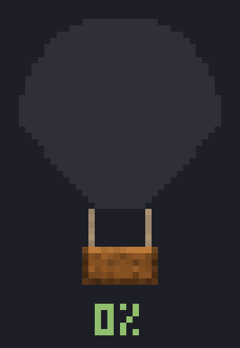
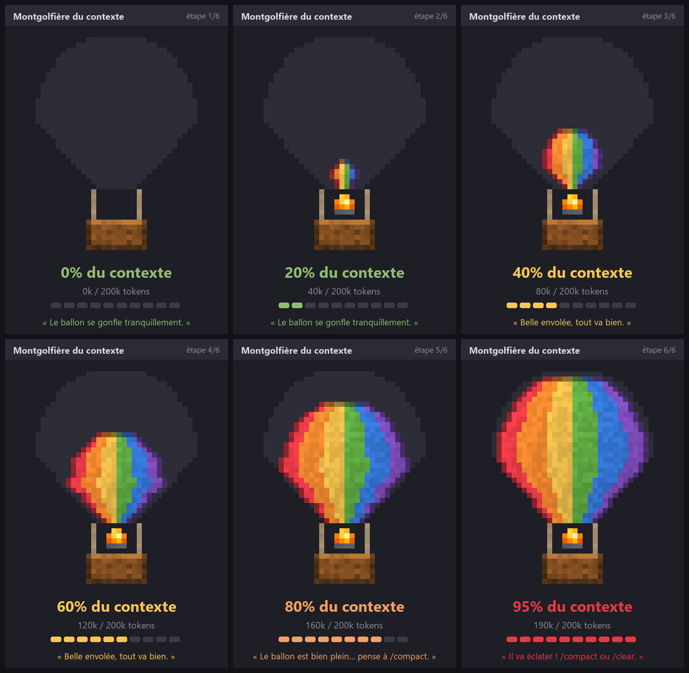

# 🎈 Montgolfière du contexte

Un mod pour Claude Code qui montre l'utilisation de ta fenêtre de contexte sous la forme
d'une montgolfière arc-en-ciel en pixel art, façon Minecraft. Au début, on ne voit que la
nacelle ; le ballon se gonfle au fur et à mesure que le contexte se remplit, jusqu'à
menacer d'éclater juste avant le compactage.

<p align="center">
  
</p>

## Pourquoi ?

Claude Code a une mémoire limitée pour chaque conversation : la fenêtre de contexte.
Quand elle est pleine, Claude résume la conversation (le compactage) et peut perdre des
détails. La montgolfière te montre d'un coup d'œil où tu en es, pour décider au bon moment
de lancer `/compact` ou de repartir sur une nouvelle conversation avec `/clear`.

## Ce que fait le mod

- **Une fenêtre dédiée** avec la montgolfière, le pourcentage de contexte utilisé, les tokens
  et le coût estimé de la session (une estimation, pas la facture). Elle s'ouvre toute seule
  au début de chaque session.
- **Une ligne discrète** au-dessus de la zone de saisie : 🎈 ▰▰▰▱▱▱▱▱▱▱ 31 %.
- **Des alertes** à 70 % et 90 % de contexte. Elles se réarment quand le contexte redescend,
  par exemple après `/compact`.
- **Des couleurs qui suivent le niveau** : vert, puis jaune, orange et rouge.



## Commandes

| Commande | Ce qu'elle fait |
| --- | --- |
| `/montgolfiere` | Rouvre la fenêtre de la montgolfière si tu l'as fermée. |
| `/contexte` | Détaille ce qui remplit le contexte, par catégorie, avec le coût estimé. |

## Installation

Dans une session Claude Code lancée depuis un terminal :

```
/plugin install montgolfiere-contexte --marketplace TOF-Pers/claude-mod-montgolfiere
```

Ou depuis un shell :

```
claude plugin install montgolfiere-contexte --marketplace TOF-Pers/claude-mod-montgolfiere
```

Réponds `y` pour ajouter la marketplace, puis choisis la portée (l'utilisateur, en premier,
pour l'avoir dans toutes tes sessions). La montgolfière apparaît à la session suivante.

Dans l'application de bureau, où `/plugin` ne fonctionne pas : clique sur **+** à côté de la
zone de saisie, puis **Plugins**, **Add marketplace** avec `TOF-Pers/claude-mod-montgolfiere`,
puis **Add plugin**.

## Mise à jour et désinstallation

```
claude plugin update montgolfiere-contexte@claude-mod-montgolfiere
```

```
claude plugin uninstall montgolfiere-contexte@claude-mod-montgolfiere
```

## Où ça s'affiche

- **Application de bureau, éditeur** : la montgolfière est une vraie image, nette à toutes les tailles.
- **Terminal** : elle est dessinée avec des demi-blocs colorés, deux pixels par caractère.

## Licence

MIT
